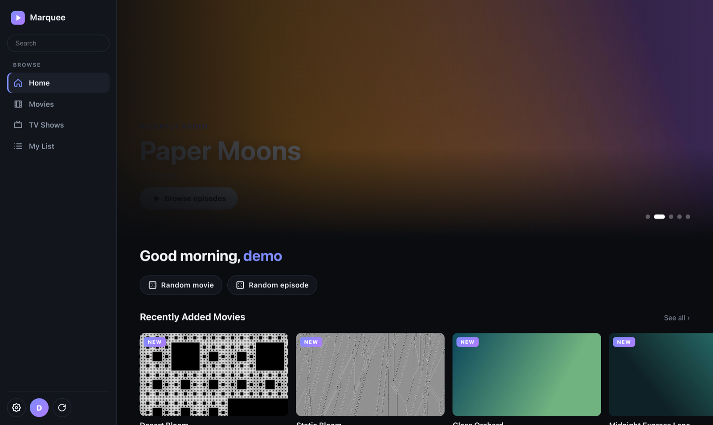
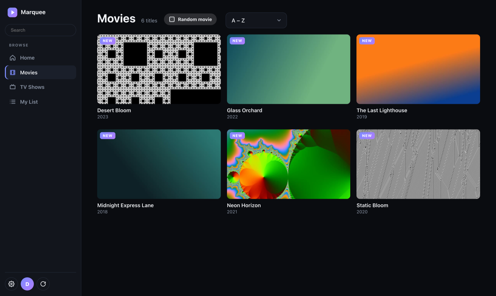
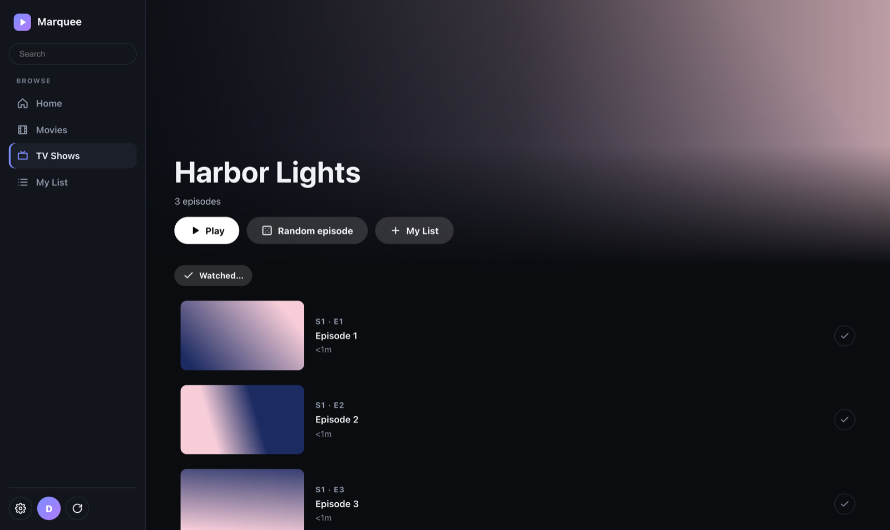
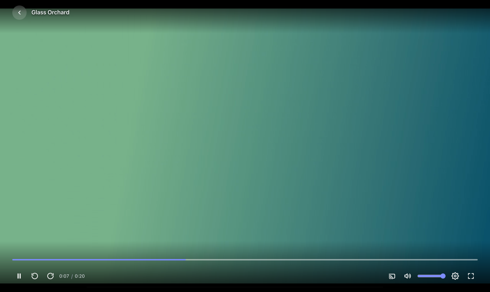
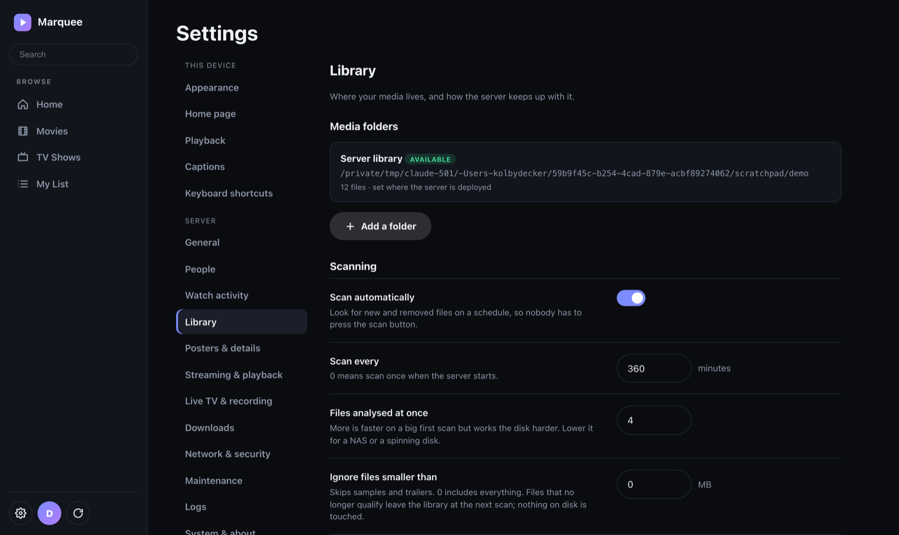

# Marquee

**A self-hosted media server for your movies, shows and live TV.** Point it at the folders where your files already live and it gives you a fast, clean web app to browse and play them from any device: phone, laptop, TV browser or Chromecast. It plays your files directly whenever the device can, and only re-encodes when it has to.

- **One small server, nothing else to run.** .NET 10, SQLite and ffmpeg. No external database, no plugins, no cloud account.
- **Direct play first, transcode last.** Your files are served untouched when the browser can decode them; otherwise only the part that needs fixing is converted (see [How playback works](#how-playback-works)).
- **Everything is configured in the browser.** The first run walks you through creating an account and picking folders. There is no config file to edit.
- **Your files are never modified.** Libraries are read-only from Marquee's point of view; it only writes to its own data folder (and to the recordings folder if you use Live TV recording).
- **Several people, one server.** Each person has their own watch history, My List, channel lists and recordings, with optional two-factor sign-in.

| | |
|---|---|
|  |  |
|  |  |

*Screenshots use a demo library with no TMDB token, so artwork is generated from video frames.*

## Contents

[Get it](#get-it) · [First run](#first-run) · [What it does](#what-it-does) · [How it works](#how-it-works) · [How playback works](#how-playback-works) · [Configuration](#configuration) · [Security](#security) · [Running it in production](#running-it-in-production) · [Development](#development) · [License](#license)

---

## Get it

### Download (Windows, macOS, Linux)

Grab the file for your system from the [Releases](../../releases) page. Each one bundles the .NET runtime, so there is nothing else to install.

| System | File | ffmpeg |
|---|---|---|
| Windows 10/11 (x64) | `Marquee-windows-x64.zip` | bundled |
| Linux x64 / arm64 | `Marquee-linux-x64.tar.gz`, `Marquee-linux-arm64.tar.gz` | bundled |
| macOS Apple Silicon / Intel | `Marquee-macos-arm64.zip`, `Marquee-macos-x64.zip` | `brew install ffmpeg` once |

Unpack it somewhere you can write to (on Windows, not Program Files), then start it:

- **Windows:** double-click `Start-Marquee.bat`. Allow it through Windows Firewall if you want other devices to connect.
- **macOS:** double-click `Start-Marquee.command`. The app is unsigned, so the first launch needs right-click → Open (or `xattr -dr com.apple.quarantine <folder>`).
- **Linux:** run `./start-marquee.sh`.

Your data (database, artwork cache, recordings, secret key) lives in the `data` folder next to the launcher. To update, unpack the new version over the old one and keep `data`.

### Docker

    docker compose up -d --build   # set the media path in docker-compose.yml first, then open http://localhost:8080

The image includes ffmpeg. An NVIDIA GPU can be used for encoding (see `Hls__Encoder` below).

### From source

Needs the .NET 10 SDK and `ffmpeg`/`ffprobe` on `PATH`.

    export Library__Root=/path/to/media          # optional: the wizard can add folders instead
    dotnet run --project src/MediaServer.Api     # http://localhost:5087

To build the packaged downloads yourself: `dotnet publish src/MediaServer.Api -c Release -r <rid> --self-contained -o out/Marquee` (rid: `win-x64`, `linux-x64`, `linux-arm64`, `osx-arm64`, `osx-x64`), then copy `packaging/windows/*` or `packaging/unix/*` next to the output. The `package` workflow does this for every platform on each `m*` tag and attaches the files to the release.

## First run

1. Open the server in a browser. With no account yet it shows **Welcome**: choose a username and password (8+ characters).
2. A short wizard asks for your **media folders** and, optionally, a **TMDB token** for posters and descriptions.
3. Marquee scans the folders in the background. Titles appear as they are found.

After that, everyone signs in on the login page. Add more people under **Settings → People**.

## What it does

### Library and browsing

- **Movies and TV Shows**, a search box, Home rows (Continue Watching, Recently Added, Live TV), detail pages with season tabs, and random movie / random episode buttons that pick something you haven't watched.
- **Automatic scanning**: shortly after startup and every `Library:ScanIntervalMinutes` (default 360). Scans find new, changed, moved and deleted files, and are fast when nothing changed. The refresh button scans on demand. Scans run in the background, so closing the tab never interrupts one.
- **Several folders**: the one the deployment mounts is always included; add more from Settings → Library (browse what the server can see). Folders can be hidden, shown again or removed. An offline drive or share is skipped rather than emptying your library. Overlapping, system and Marquee's own folders are refused.
- **Artwork without TMDB**: cards and banners use a frame grabbed from the video. With a [TMDB](https://www.themoviedb.org) token you get real posters, backdrops, descriptions, genres and ratings, and the UI switches to poster cards. Titles that can't be matched are listed under *Needs a match*; open one and choose **Fix match** to pick the right entry (for a show, this applies to every episode).
- **Watch progress is kept on the server**, so Continue Watching and resume follow you between browsers. "Up next" appears when the latest episode of a show is finished. **My List** and **Watched…** (mark a season or whole show watched or unwatched) are on every show page.

### The player

- Keyboard: space/k play, j/l or arrows seek, f fullscreen, m mute, n next, c captions, i stats, Esc back.
- **Skip intro / Skip credits** when the file has chapters named like "Opening" or "Credits", **seek-bar previews**, **audio track** and **subtitle** menus, **playback speed**, and a **quality** picker.
- **Captions**: text tracks inside the file and `.srt` / `.vtt` / `.ass` files next to it (`Movie.en.srt`) are converted to WebVTT on demand. Picture subtitles (PGS, DVD) can be burned into the video (this re-encodes it).
- **Cast**: AirPlay in Safari; Chromecast in Chrome (needs a secure page, and a plain-http address for the TV; set *Address for casting* in Settings → Network & security).
- **Stats for nerds** (the cog, or `I`): play mode and why, source and output formats, bitrate, decoded vs displayed size, dropped frames, buffer, network speed, encoder and segment progress, and the browser's capabilities, with a Copy button for bug reports.
- Posters show how much of a title is left ("42m left") and a check mark once it's watched.
- **Install it as an app** from the browser menu (phone or desktop; needs HTTPS or localhost).

### Intro and credits finder

When a file has no chapters, Marquee listens to the first and last minutes of each episode and compares them with the other episodes of the season. Sound that repeats (the theme tune, the credits music) becomes Skip intro / Skip credits. For films it looks for the fade to black before the credits. It needs at least two episodes in a season, works one title at a time in the background (progress under Maintenance), and never changes your files.

### Live TV and recording

Point Marquee at an IPTV source (for example Dispatcharr) and it adds a **Live TV** section: a guide timeline, channel list, favourites, channel surfing (`[` / `]` or type a number) and a "Go live" button. Make your own named **channel lists**.

- **Record** from the guide (●) or while watching. Recordings are plain files in `Recordings__Directory` (default `<data folder>/recordings`) and appear in the library like any title. Settings cover how many at once, padding before and after, auto-delete and a free-space limit.
- Clients never supply URLs: stream addresses stay on the server and are never returned by any API or written to logs. One live stream runs at a time, remuxed or transcoded to HLS by the same policy as library playback, and it reconnects if the source drops.

| Setting | Meaning |
|---|---|
| `LiveTv__M3uUrl` | M3U playlist URL (http/https only) |
| `LiveTv__EpgUrl` | XMLTV guide URL (optional; defaults to the playlist's `url-tvg`) |
| `LiveTv__StreamOrigin` | Rewrites stream URLs to this origin, for playlists that advertise an address the server can't reach |
| `LiveTv__RefreshMinutes` | How often the playlist and guide are re-imported |

### Radarr and Sonarr

Settings → Downloads: save each app's address and API key (Sonarr v4). **Downloads** in the menu then shows what's downloading and what's coming in the next three weeks, and lets you search for a movie or show and add it with the quality and folder you choose. Add the webhook address shown in Settings to each app (Connect → Webhook, "On Import") and new files appear in your library within seconds. A search that finds nothing offers to look in Radarr and Sonarr.

### People, activity and appearance

- **People**: administrators add and remove people and reset passwords; ordinary people can't change server settings. Optional two-step sign-in: an authenticator app (TOTP) plus one-time recovery codes.
- **Watch activity** (administrators): who is watching right now, plus hours watched per day, per person and per title over 7, 30 or 90 days. Time is counted from the player's own progress saves, so seeking ahead or leaving a video paused adds nothing.
- **Appearance**: accent colour, light / midnight / pure black / automatic themes, text size, grid density, reduced motion, and which rows appear on Home.
- **System & about**, **Logs** (live, filterable, copyable) and **Maintenance** (scan, refresh Live TV or metadata, clear caches, compact and back up the database, clear watch history).

## How it works

Marquee is one ASP.NET (.NET 10, Minimal APIs) process that serves a JSON API and a dependency-free web app, with SQLite for state and ffmpeg for anything that touches media.

    Browser (single-page app, no build step)
        │   JSON API + HLS / range streaming, signed in with a session cookie
        ▼
    ┌──────────────────── MediaServer.Api ────────────────────┐
    │  Auth & users ── Settings ── Library scanner & queries  │
    │  Metadata (TMDB) ── Live TV ── Recording ── Radarr/Sonarr│
    │  Playback policy ── HLS sessions ── Range streamer      │
    └──────┬───────────────────────────┬─────────────────────┘
           ▼                           ▼
       SQLite (data/)          ffmpeg / ffprobe processes
                                       ▼
                         your media files (read-only)

- **Scanning.** Incremental and idempotent; see [How scanning works](#how-scanning-works).
- **IDs, not paths.** Media is addressed by database ID. Clients never send a file path, so there is no path traversal surface and folders can be moved without breaking links.
- **Metadata.** With a TMDB token, titles are matched once per distinct title (not per file). Responses are cached in SQLite (details 30 days, searches 2 days, misses 1 day, stale-if-error) and images on disk. Manual matches are never overwritten by automatic matching.
- **Playback.** The browser reports what it can decode; the server picks the cheapest path per file (next section). Progress is saved on the server.
- **Web app.** Plain JavaScript in `wwwroot/` (no framework, no bundler), with hls.js vendored so it works offline. Responses carry a strict Content-Security-Policy (no inline scripts), and any unexpected failure becomes a short JSON error with a reference id that appears in Settings → Logs.
- **Settings.** *This device* settings live in the browser; *Server* settings live in the database and apply to everyone immediately (no restart). Only whitelisted settings can be changed this way: library paths, tool paths, the database location and the sign-in switch stay deployment-only. Saved values override environment variables; "Use the default" removes the override.
- **Background work** (all in-process): automatic scans, Live TV refresh, recording, the intro/credits finder, seek-preview generation and cache clean-up.
- **Health.** `GET /health` (alive) and `GET /health/ready` (database reachable).

### How scanning works

A scan is a cheap comparison between what is on disk and what the database already knows. Only files that are new or changed are sent to `ffprobe`.

1. **Walk the folders.** Every enabled library folder is walked recursively (the primary folder, any folders added in Settings, and the recordings folder). Only these extensions are considered: `.mkv .mp4 .m4v .avi .mov .webm .ts .m2ts .wmv .mpg .mpeg`. Hidden and system files, dot-folders and Synology `@eaDir` folders are skipped, and so is anything the **ignore rules** exclude: files below a minimum size (samples, trailers) or with one of your ignore words (`sample`, `extras`, `featurettes`…) in the folder or file name. A file that stops matching just drops out of the library on the next scan; nothing on disk is touched.
2. **Compare with the database.** Each file is identified by its path and a *stamp* of size plus last-modified time:
   - **Same path, same stamp:** unchanged. It is never re-probed (unless the probe parser has since learned new fields, in which case it is probed once more).
   - **Same path, different stamp:** changed. It is re-probed and updated in place, keeping its ID, so watch history stays attached.
   - **New path:** if a file that has vanished from another path has the same stamp, it is treated as a **move or rename** and keeps its ID (and so its progress, My List entries and manual TMDB match). If several candidates fit, one with the same file name wins; otherwise the first match is used. A file that was both moved and edited has a different stamp, so it shows up as a delete plus a new file.
   - **Otherwise:** a new file, which gets probed and inserted.
3. **Soft deletes.** Files that have disappeared are marked deleted, not erased, and are restored (same ID) if they come back at the same path with the same stamp. This is what makes an unplugged drive or a remounted share harmless: a folder that is unavailable is skipped and its files are left exactly as they are. The primary folder is stricter: if it is missing, the scan fails rather than emptying your library.
4. **Probe in parallel.** New and changed files are probed concurrently (`Library:ProbeParallelism`, default 4, further bounded by the process runner). A file ffprobe can't read is still recorded, with its error, so one bad file never stops a scan and the problem is visible in the logs.
5. **Write once.** All moves, restores, removals, inserts and updates are applied in a single SQLite transaction, then names are parsed (`FilenameParser`) into kind, title, year, season, episode and air date for new and moved rows, and for any row parsed by an older version of the parser. Recordings such as `News at Six [2026-11-06 1800].ts` are named from the file and never mistaken for a movie or an episode.

Scans are serialised: only one runs at a time, and asking for another while one is running does nothing. They run independently of any web request, so a closed tab or proxy timeout never aborts one. After each scan Marquee fetches TMDB metadata for new titles (if a token is set) and, when anything was added, updated or moved, queues the intro and credits finder, since new episodes may now have neighbours to compare against. The result of the last scan (added, updated, moved, restored, removed, unchanged, probe errors) is shown in the web app and the logs.

When scans happen: about 5 seconds after startup, then every `Library:ScanIntervalMinutes` (default 360; `0` means startup only), unless `Library:AutoScan=false`. These settings are re-read every cycle, so changing them in Settings takes effect without a restart. The refresh button, or `POST /api/library/scan`, scans on demand.

### Code map

| Folder (`src/MediaServer.Api/`) | What's there |
|---|---|
| `Library/` | scanning, file-name parsing, folders, queries, progress, chapters, intro/credits detection |
| `Probing/`, `Processes/` | ffprobe parsing and a bounded ffmpeg/ffprobe process runner |
| `Hls/`, `Streaming/` | playback planner, ffmpeg command builder, HLS sessions, HTTP range streaming |
| `Metadata/` | TMDB client, matcher, image cache |
| `LiveTv/`, `Recording/` | M3U/XMLTV import, guide, recording scheduler |
| `Arr/` | Radarr and Sonarr integration |
| `Auth/`, `Security/` | accounts, sessions, 2FA, encryption of stored secrets, HTTPS certificates |
| `Settings/`, `Maintenance/`, `Data/` | settings service, maintenance tasks, SQLite access |
| `Endpoints/` | the HTTP API |
| `wwwroot/` | the web app |

## How playback works

The browser reports what it can decode (`?v=h264,hevc&a=aac,eac3&c=mp4,mkv`, detected with `canPlayType`), and the server picks the cheapest path per file:

1. **Direct play** (`GET /stream/{id}`, with `Range` requests): the container, video and default audio track are all supported. The file is served as is; no server work.
2. **Direct stream** (`POST /api/hls/start`): the video is supported but the container or audio isn't (for example HEVC + EAC3 in MKV). The video is **copied untouched** into HLS (HEVC into fMP4 tagged `hvc1`, H.264 into MPEG-TS) and only the audio is converted to stereo AAC. Nearly free, no GPU.
3. **Transcode**: only when the browser cannot decode the video at all (for example HEVC in Firefox, VC-1, 4:4:4 or old MPEG-4 AVIs). Video goes to 8-bit H.264 (`Hls__Encoder=nvenc` uses the GPU), audio to AAC.

If a browser claims support and then fails, the player steps down automatically: direct play, then direct stream, then transcode. No browser decodes VC-1, MPEG-4 Part 2, DTS or TrueHD, so those always need the video or audio converted. Safari plays HLS through its native player (HEVC in fMP4 needs it); other browsers use the bundled hls.js.

**Quality picker.** Choose Original or a lower resolution (1080p / 720p / 480p / 360p, each with a bitrate cap; only sizes the file can fill are offered). The choice is remembered and playback continues from the same moment.

**Seeking in transcodes.** A transcode gets its full-length playlist up front, so the scrubber shows the whole movie and playback can start anywhere (resume, quality change). Segment N always covers `[N×6s, (N+1)×6s)` of the source; if you seek far from where the encoder is, the server restarts ffmpeg at that segment (one ffmpeg per session; the old one is killed). Runs started by different seeks line up on one timeline: segmented encodes use no B-frames, a fixed 48 kHz AAC track and a constant timestamp offset, verified by a test that stitches segments from separate runs and checks every frame sits on the 40 ms grid. Direct-streamed (copied) video keeps a growing playlist because its segment boundaries depend on the source's keyframes. Seeking beyond what has been encoded so far waits for the encoder (fast for remux, usually faster than realtime for transcodes).

**Clean-up.** ffmpeg is killed (whole process tree) and its directory removed when the tab closes, the player navigates away, the idle timeout passes (the page pings every 15 s), a newer session evicts it, or the server shuts down.

| Setting | Default | Meaning |
|---|---|---|
| `Hls__Encoder` | `libx264` | `nvenc` uses `h264_nvenc` (needs an ffmpeg with NVENC and GPU access) |
| `Hls__MaxSessions` | `2` | Starting another evicts the least recently used |
| `Hls__IdleSeconds` | `120` | No ping or segment request for this long ⇒ ffmpeg is killed |
| `Hls__SegmentSeconds` | `6` | |
| `Hls__TempDir` | `$TMP/mediaserver-hls` | Wiped at startup |
| `Tools__FfmpegPath` / `Tools__FfprobePath` | `ffmpeg` / `ffprobe` | |

## Configuration

Almost everything is changed in the web app under **gear icon → Settings**. Environment variables (use `__` for `:`) set deployment-level defaults:

| Variable | Meaning |
|---|---|
| `Library__Root` | A media folder that is always included (`/media` in Docker) |
| `Library__AllowedRoots` | `;`-separated list limiting where folders may be added in the UI |
| `Library__AutoScan` / `Library__ScanIntervalMinutes` | Automatic scanning (default on, every 360 min; `0` = startup only) |
| `Database__Path` | SQLite file (default `data/mediaserver.db`; keep it on a local disk) |
| `Images__CacheDir` | Artwork and thumbnail cache |
| `Tmdb__ReadAccessToken` | TMDB v4 read access token (or `Tmdb__ApiKey`); in Kubernetes, supply it from a Secret |
| `Recordings__Directory` | Where recordings are written |
| `Auth__Enabled`, `Auth__SetupCode`, `Auth__TrustProxy` | See [Security](#security) |
| `Https__Enabled`, `Https__Port`, `Https__Hostnames`, `Https__CertificatePath` | See [Security](#security) |
| `Security__SecretKey` | Key for encrypting stored secrets (see below) |

The settings screens, in order: **Appearance**, **Home page**, **Playback**, **Captions** and **Keyboard shortcuts** (these are per device); then, for the whole server, **General** (server name), **People**, **Watch activity**, **Library**, **Posters & details**, **Streaming & playback**, **Live TV & recording**, **Downloads**, **Network & security**, **Maintenance**, **Logs**, **System & about**, and your own **Account & devices**.

### TMDB matching from the command line

    dotnet user-secrets set "Tmdb:ReadAccessToken" "<v4 read access token>" --project src/MediaServer.Api
    curl -X POST localhost:5087/api/library/enrich

Wrong match? Find the right id with `GET /api/tmdb/search?type=movie&q=...`, then:

    PUT    /api/media/{id}/match   {"tmdbType":"movie","tmdbId":603,"scope":"file"}   # scope "title" = whole series
    DELETE /api/media/{id}/match?scope=file                                           # back to automatic matching

`Tmdb:BaseUrl` / `Tmdb:ImageBaseUrl` can point at a different TMDB-compatible server (used for local testing).

## Security

- **Accounts.** Passwords are salted PBKDF2-SHA256 hashes. Sessions are random cookies (HttpOnly, SameSite=Lax; `Secure` over HTTPS), kept in the database only as hashes, valid 30 days with "Keep me signed in" or 12 hours of inactivity otherwise. Wrong passwords are slowed down per address, and changing your password signs out your other devices.
- **Everything under `/api` and `/stream` needs a session.** Players that don't send cookies (Safari's native video/HLS) use short-lived signed links for that one file, and HLS sessions use their unguessable ids.
- **Claiming a fresh server.** `Auth__SetupCode=<anything>` makes the first-run form ask for that code, so nobody else can claim a newly deployed server.
- **Behind a reverse proxy**, set `Auth__TrustProxy=true` so login throttling sees each visitor's `X-Forwarded-For` address instead of the proxy's.
- **Turning sign-in off.** `Auth__Enabled=false` disables it entirely (for example if your proxy already authenticates). Settings and folders are then open to anyone who can reach the server, so folder editing in the web UI is refused unless you also set `Library__AllowFolderEditing=true`.
- **Lost your password?** Stop the server and delete the account: `sqlite3 mediaserver.db "DELETE FROM users;"`. The next visit shows setup again.
- **Secrets are encrypted at rest** (AES-256-GCM): the TMDB token, the Live TV playlist and guide URLs, channel stream URLs and each person's two-factor secret. The key is `Security__SecretKey` (32 random bytes, base64: `openssl rand -base64 32`) or, if you don't set it, a `secret.key` file created next to the database. **Keep the key out of backups**: the built-in backup (Settings → Maintenance) is the database only. Lose the key and the saved secrets are treated as "not set" (you enter them again); nothing else is affected.
- **HTTPS.** Terminate TLS in your reverse proxy (recommended), or set `Https__Enabled=true` for a built-in HTTPS port (`Https__Port`, default 8443) with a self-signed certificate kept next to the database (`Https__Hostnames` adds names; download the certificate from Settings → Network & security to trust it on a device), or bring your own with `Https__CertificatePath` / `Https__CertificatePassword`. `Https__RedirectHttp` and `Https__Hsts` are optional.
- **Folders.** Library folders can't be system locations or Marquee's own data, and `Library__AllowedRoots` can limit where they may be added.

## Running it in production

- Put it behind a reverse proxy with TLS and set `Auth__TrustProxy=true`.
- Set `Auth__SetupCode` before exposing a new server, and `Security__SecretKey` from your secret store.
- Mount the media read-only; give `/data` (database, artwork) and the transcode folder real disk.
- For GPU encoding in Docker, give the container access to the NVIDIA runtime and set `Hls__Encoder=nvenc`.
- CI (`.github/workflows/ci.yml`) runs the tests, lints the web app, builds the image, smoke-tests it and pushes it to `ghcr.io` on `main` and on `m*` tags.

## Development

    dotnet test                          # server tests (warnings are errors)
    node --test web-tests/*.test.js      # unit tests for the page's pure logic (shared.js)
    npx eslint@9 -c eslint.config.mjs 'src/MediaServer.Api/wwwroot/*.js' 'web-tests/*.js'

Chromecast and AirPlay need real devices to try and are not covered by the automated tests.

## License

MIT. See [LICENSE](LICENSE). The bundled hls.js (`wwwroot/vendor`) is Apache-2.0; its license text is alongside it.
